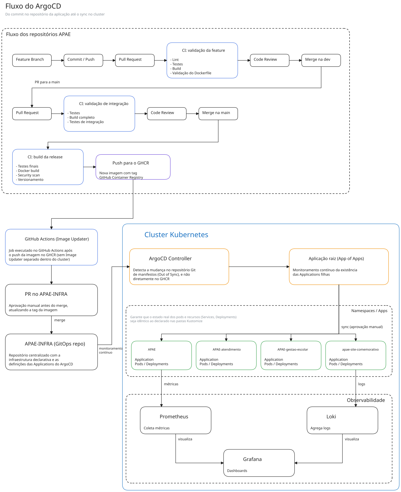

# Fluxo do ArgoCD (GitOps)

## Visão geral

O **APAE-INFRA** é o repositório GitOps: a única fonte de verdade lida pelo ArgoCD dentro do cluster Kubernetes. Os 4 repositórios de aplicação (`APAE`, `APAE-atendimento`, `APAE-gestao-escolar`, `apae-site-comemorativo`) nunca aplicam manifestos diretamente no cluster — eles apenas publicam imagens de container no **GHCR**. Quem atualiza o estado desejado do cluster é sempre um commit no APAE-INFRA, e quem aplica esse estado é sempre o ArgoCD.

Isso garante o princípio central do GitOps: **o Git é a única fonte de verdade** e o histórico de commits do APAE-INFRA é, ao mesmo tempo, o histórico de deploys.



## AppProject: governança compartilhada

Antes de falar de Applications, existe um único **`AppProject`** (`apae`) que todas elas compartilham. O `AppProject` não implanta nada sozinho — ele é a camada de permissão/segurança que orienta e padroniza como as Applications dos repositórios envolvidos podem se comportar:

- `sourceRepos`: só o próprio APAE-INFRA pode ser usado como fonte de manifestos (nenhuma Application pode apontar para um repositório fora do GitOps);
- `destinations`: os namespaces `apae-*` (para os workloads das aplicações) e o namespace `argocd` (necessário para que a Application raiz `apae-root` gerencie os objetos `Application` filhos);
- `clusterResourceWhitelist`: restringe quais tipos de recurso Kubernetes uma Application pode criar (evita, por exemplo, que uma Application de aplicação crie um `ClusterRole` sem necessidade).

```yaml
# argocd/project.yaml
apiVersion: argoproj.io/v1alpha1
kind: AppProject
metadata:
  name: apae
  namespace: argocd
spec:
  description: Projeto único orientando as Applications da APAE
  sourceRepos:
    - https://github.com/IFPBEsp/APAE-INFRA.git
  destinations:
    - namespace: 'apae-*'
      server: https://kubernetes.default.svc
    - namespace: 'argocd'
      server: https://kubernetes.default.svc
  clusterResourceWhitelist:
    - group: '*'
      kind: Namespace
```

## Padrão adotado: App of Apps

O padrão **[App of Apps](https://argo-cd.readthedocs.io/en/stable/operator-manual/cluster-bootstrapping/)**
separa a Application raiz (`apae-root`) das Applications de workloads. O
bootstrap e os AppProjects são responsabilidade da #91/Ansible. A raiz deve
descobrir somente as Applications autorizadas para o ambiente de destino.
O PR #120 define três filhas em `argocd/apps/dev/`: `apae-geral-dev`,
`apae-atendimento-dev` e `site-comemorativo-dev`. Seu registro efetivo no cluster
ainda depende da integração do bootstrap; Gestão Escolar depende da #38/#92.

No modelo de bootstrap proposto em [gerenciamento da VPS](../ansible/07-arquitetura-proposta-e-proximos-passos.md), um playbook Ansible instala ArgoCD, aplica o `AppProject` e registra a Application raiz. Como a configuração abaixo exclui `project.yaml` e `app-of-apps.yaml` do path reconciliado, esses objetos permanecem sob ownership do bootstrap Ansible; alterações neles exigem apply controlado do playbook. A raiz reconcilia as Applications filhas e, por elas, os recursos atribuídos ao ArgoCD.

**Importante — são dois loops de sincronização independentes, rodando em paralelo o tempo todo:**

1. **Loop da raiz**: mantém os objetos `Application` autorizados pelo seu filtro de descoberta. Alterar uma definição de Application afeta esse loop; atualizar apenas a imagem no overlay não o afeta.
2. **Loop de cada Application filha**: cada uma monitora seu próprio `source.path` (o overlay Kustomize da aplicação dela) e garante que o Deployment/Service/etc. estejam como descrito lá. É esse loop que entra em Out-of-Sync quando a tag da imagem é atualizada.

Após a ativação do bootstrap, a raiz mantém as filhas autorizadas registradas continuamente; ela não as descobre por um push de imagem. Quem reage ao push de imagem é diretamente a Application filha correspondente, porque foi o overlay dela que mudou.

Vantagens do App of Apps neste contexto:

- Uma Application autorizada pode ser registrada pela raiz após a integração do bootstrap, sem aplicação manual individual. A descoberta de novos ambientes precisa ser configurada explicitamente; manifests de produção não pertencem a `argocd/apps/dev/`;
- O próprio conjunto de Applications fica versionado e auditável junto com o resto da infraestrutura;
- As três filhas iniciais seguem a separação por ambiente definida no PR #120 (`argocd/apps/dev/`).

### Estrutura de diretórios

```text
argocd/
  app-of-apps.yaml               # raiz; bootstrap da #91
  project.yaml                   # AppProject dos produtos
  project-infra.yaml             # AppProject da infraestrutura
  apps/dev/
    apae-geral-dev.yaml
    apae-atendimento-dev.yaml
    site-comemorativo-dev.yaml
```

O PR #120 define esses três manifests e seus overlays. Gestão Escolar depende
primeiro dos manifests base da #38. `dev` representa homologação neste fluxo;
a promoção para `prod` será implementada na #106, sem introduzir `hml`.

### Applications estáticas

Será adotado uma abordagem para escrever manualmente um YAML de `Application` por repositório — abordagem mais simples de entender e depurar enquanto o time ainda está validando o funcionamento do ArgoCD. Ela tem caminho de evolução direto: quando o número de aplicações/ambientes crescer, o mesmo padrão de pastas pode ser consumido por um `ApplicationSet` sem precisar reestruturar nada.

A definição da raiz e seu filtro de descoberta pertencem ao bootstrap da #91;
não são alterados pelo receptor. O exemplo abaixo ilustra o sync manual
requerido para homologação; consulte a divergência com o PR #120 adiante.

```yaml
# argocd/apps/dev/apae-geral-dev.yaml — exemplo com sync manual requerido
apiVersion: argoproj.io/v1alpha1
kind: Application
metadata:
  name: apae-geral-dev
  namespace: argocd
spec:
  project: apae
  source:
    repoURL: https://github.com/IFPBEsp/APAE-INFRA.git
    targetRevision: main
    path: kubernetes/apae-geral/overlays/dev     # Kustomize overlay
  destination:
    server: https://kubernetes.default.svc
    namespace: apae-dev
  syncPolicy: {}   # sync manual — ver seção de Política de Sincronização
```

> O sync da raiz e o das filhas são independentes. O requisito deste fluxo é
> revisão do PR e sync manual das filhas de homologação; os manifests do PR #120
> ainda precisam ser alinhados a esse requisito.

Os manifests correspondentes aos outros produtos estão em
`argocd/apps/dev/apae-atendimento-dev.yaml` e
`argocd/apps/dev/site-comemorativo-dev.yaml`. Não há Application de Gestão
Escolar definida no PR #120.

### Evolução futura: ApplicationSet

Quando o número de aplicações/ambientes crescer o suficiente para tornar repetitivo escrever um YAML por combinação, o mesmo padrão de pastas pode ser consumido por um único `ApplicationSet`, que gera as Applications automaticamente:

```yaml
apiVersion: argoproj.io/v1alpha1
kind: ApplicationSet
metadata:
  name: apae-apps
  namespace: argocd
spec:
  generators:
    - git:
        repoURL: https://github.com/IFPBEsp/APAE-INFRA.git
        revision: main
        directories:
          - path: kubernetes/*/overlays/dev   # somente homologação; evolução futura
  template:
    metadata:
      name: '{{path[1]}}-{{path.basenameNormalized}}'   # ex: apae-geral-dev
    spec:
      project: apae
      source:
        repoURL: https://github.com/IFPBEsp/APAE-INFRA.git
        targetRevision: main
        path: '{{path}}'
      destination:
        server: https://kubernetes.default.svc
        namespace: apae-dev
      syncPolicy: {}   # manter manual até a decisão de automatizar prod
```

Essa migração não é destrutiva: pode ser feita substituindo os arquivos estáticos de `argocd/apps/dev/` pelo `ApplicationSet` quando fizer sentido, sem alterar a estrutura de pastas do Kustomize.

## De onde cada Application lê os manifestos

Cada `Application` lê exclusivamente do próprio **APAE-INFRA**, usando **Kustomize**:

- `kubernetes/{produto}/base/` — manifestos comuns (Deployment, Service, etc.) da aplicação;
- `kubernetes/{produto}/overlays/{ambiente}/` — patches específicos do ambiente (réplicas, recursos, variáveis, tag de imagem via `kustomization.yaml`).

## Alinhamento pendente com #92/#106

O overlay `dev` é a homologação; a branch dos manifests continua sendo `main`.
O PR #97 implementa o receptor e rejeita `hml` e `prod`. A #106 implementará a
integração dos produtos com publicação na `main`, envio do dispatch e promoção
dos mesmos digests para `prod`. Após conferir a tag e o digest no GHCR, o
receptor autentica a proveniência com GitHub Attestations antes de gerar o
token de escrita. Também exige o HEAD atual da `main` do produto na recepção
e antes da abertura ou atualização do PR.
A #82 deve permanecer aberta até o aceite operacional com imagens reais.

O PR #120 declara sync **automático** em `dev`, com `prune` e `selfHeal`, ao
contrário do sync manual requerido abaixo para homologação. Alinhar essa
política com #92/#106 antes da ativação. Os exemplos manuais deste documento
expressam o requisito, não uma alteração já aplicada aos manifests do #120.
Este PR não modifica Applications nem a arquitetura de bootstrap.

O bootstrap da #91 deve impedir que a raiz de produção descubra indevidamente
as Applications de `argocd/apps/dev/`. A descoberta e o destino apropriados,
o namespace `apae-dev` e a presença dos overlays em `main` são pré-requisitos
operacionais; a estrutura de pastas, sozinha, não habilita nem isola o sync.

## Política de sincronização

**Decisão para este momento do projeto: sync manual (aprovação humana) em todas as Applications filhas.**

| Configuração | Valor definido | Motivo |
| --- | --- | --- |
| `syncPolicy.automated` (Applications filhas) | **desabilitado** | o ArgoCD sinaliza "Out of Sync", mas só aplica quando alguém aprovar manualmente (UI ou `argocd app sync`) |
| `syncPolicy.automated` (Application raiz) | habilitado (`selfHeal` + `prune`) | a raiz só gerencia a existência das definições de Application, risco baixo — não afeta workloads diretamente |
| `selfHeal` (filhas) | desabilitado por enquanto | consequência do sync manual: mudanças manuais no cluster não são revertidas automaticamente até a transição abaixo |
| `prune` (filhas) | avaliar caso a caso durante o sync manual | evita remoção automática de recursos sem revisão humana |

### Por quê começar manual

O pipeline de CI/CD dos 4 repositórios de aplicação ainda está em maturação (sem gate de testes obrigatório, sem processo de release consolidado). Sync manual garante um checkpoint humano antes de qualquer mudança chegar ao cluster, reduzindo o risco de um bump de imagem ruim ou um manifesto com erro já impactar o ambiente sem ninguém perceber.

### Critério de transição para automático

A migração de manual para `automated` (com `selfHeal`/`prune`) deve ocorrer quando:

- o pipeline de CI/CD dos repositórios de aplicação tiver testes automatizados obrigatórios antes do merge; e
- houver um histórico de releases consecutivas sem necessidade de rollback manual.

Até lá, cada Application filha permanece com `syncPolicy: {}` (sem `automated`), exigindo que alguém revise o "Out of Sync" no ArgoCD e aprove o sync manualmente.

## Image Updater: GitHub Actions (não o ArgoCD Image Updater)

O receptor GitOps do PR #97, relacionado à issue #82, está documentado em [Atualização de imagens nos overlays GitOps](../workflows/update-image-overlay.md). O workflow propõe PRs para `main`, fixa a imagem por digest e preserva tag e commit de origem no PR. Os overlays e as Applications são pré-requisitos da #92; a aprovação do PR é seguida pelo sync manual previsto abaixo.

A notificação de uma nova publicação ficará em um **job do pipeline de GitHub Actions** dos produtos (#106); a validação do evento e a atualização do digest serão executadas no APAE-INFRA pelo receptor do PR #97 — não no componente separado "ArgoCD Image Updater". Motivo: evita rodar mais um controller com credenciais de escrita dentro do cluster, mantém rastreabilidade direta entre o commit de infra e o run de CI que o gerou, e reage imediatamente ao push (sem espera de polling).

## Como uma mudança se propaga até o cluster

Duas origens de mudança, dois fluxos — mas **ambos terminam exigindo aprovação manual no ArgoCD**, já que o sync das Applications filhas não é automático.

### 1. Novo manifesto / config (mudança direta no APAE-INFRA)

1. Alguém abre um PR no APAE-INFRA alterando `kubernetes/{produto}/base/` ou `kubernetes/{produto}/overlays/dev/`;
2. PR é revisado e mergeado em `main`;
3. O **ArgoCD Controller** (que já monitora continuamente todas as Applications, raiz e filhas, em paralelo) detecta que a Application filha correspondente está **Out-of-Sync** em relação ao Git;
4. Como o `syncPolicy` dessa Application filha é manual, o ArgoCD **não aplica sozinho** — apenas sinaliza o estado Out-of-Sync;
5. Alguém do time revisa a diferença no ArgoCD (UI ou CLI) e aprova o sync manualmente;
6. O ArgoCD aplica (`kubectl apply`/`prune`) os recursos correspondentes, atualizando os Pods/Deployments do namespace afetado.

### 2. Nova imagem de aplicação (deploy de código)

O envio pelos produtos ainda será integrado na #106. Fluxo previsto:

1. Um push/merge na `main` de um dos repositórios de aplicação (APAE, APAE-gestão escolar, APAE-atendimento ou APAE-site-comemorativo) dispara o pipeline de **CI** (GitHub Actions);
2. O CI builda a imagem e faz o **push da imagem** para o **GHCR** (Container Registry);
3. O produto notificará o receptor por `repository_dispatch` do tipo `gitops-image-published`; o receptor confere a tag e o digest no GHCR e propõe a atualização do digest no `kustomization.yaml` do overlay correspondente do APAE-INFRA (ex.: `kubernetes/apae-geral/overlays/dev`), via PR para `main`, com revisão humana antes do merge;
4. A partir daqui o fluxo é o mesmo do caso 1: o ArgoCD Controller detecta que **a Application filha daquele repositório** está Out-of-Sync (a raiz não é afetada, pois a definição das Applications em `argocd/` não mudou — apenas o conteúdo do overlay que a Application filha já apontava);
5. Alguém aprova o sync manualmente no ArgoCD;
6. O ArgoCD sincroniza a Application filha: normalmente isso é um **rolling update** do Deployment já existente (novos Pods sobem com a imagem nova do GHCR e os antigos são removidos gradualmente) — só no primeiro deploy daquela aplicação/ambiente é que os Pods são criados do zero.

Em ambos os casos, **a única forma de o cluster mudar é através de um commit no APAE-INFRA seguido de aprovação manual no ArgoCD** — nunca há `kubectl apply` manual nem alteração direta do GHCR/CI no cluster.

### Comportamento da Application raiz dentro do ArgoCD

Após a integração e validação do bootstrap, a Application raiz (`apae-root`) mantém as filhas autorizadas registradas no cluster, independentemente de qualquer push de imagem. O que acontece a cada deploy é a Application filha *já existente* entrando em Out-of-Sync porque o conteúdo do overlay que ela aponta mudou — não a criação de uma Application nova.

## Relação entre as Applications e os repositórios de aplicação

Mapeamento definido no PR #120 e dependências pendentes:

| Repositório de aplicação | Application filha no ArgoCD | Overlay consumido |
| --- | --- | --- |
| `APAE` | `apae-geral-dev` | `kubernetes/apae-geral/overlays/dev` |
| `APAE-gestao-escolar` | Pendente de #38/#92 | Pendente de #38/#92; caminho não definido |
| `APAE-atendimento` | `apae-atendimento-dev` | `kubernetes/apae-atendimento/overlays/dev` |
| `APAE-site-comemorativo` | `site-comemorativo-dev` | `kubernetes/site-comemorativo/overlays/dev` |

Cada repositório de aplicação é responsável apenas pelo seu código, pelo build/push da imagem e pelo job de Image Updater no CI; o *deploy* em si (quais recursos existem, quantas réplicas, em qual namespace) é responsabilidade exclusiva do APAE-INFRA e das Applications do ArgoCD.

## Observabilidade

As Applications de workload rodam no mesmo cluster monitorado pela stack de observabilidade (também gerenciada via GitOps, no mesmo padrão App of Apps):

- **Prometheus** coleta métricas dos Pods/Deployments de todas as aplicações;
- **Grafana** visualiza as métricas do Prometheus em dashboards;
- **Loki** centraliza os logs dos Pods, também visualizados no Grafana.

## Referências

- [Diagrama do Fluxo do ArgoCD (SVG)](../diagramas/fluxo-argocd.svg)
- [Diagrama editável no Excalidraw](../diagramas/fluxo-argocd.excalidraw)
- [Documentação Oficial do ArgoCD - App of Apps](https://argo-cd.readthedocs.io/en/stable/operator-manual/cluster-bootstrapping/)
