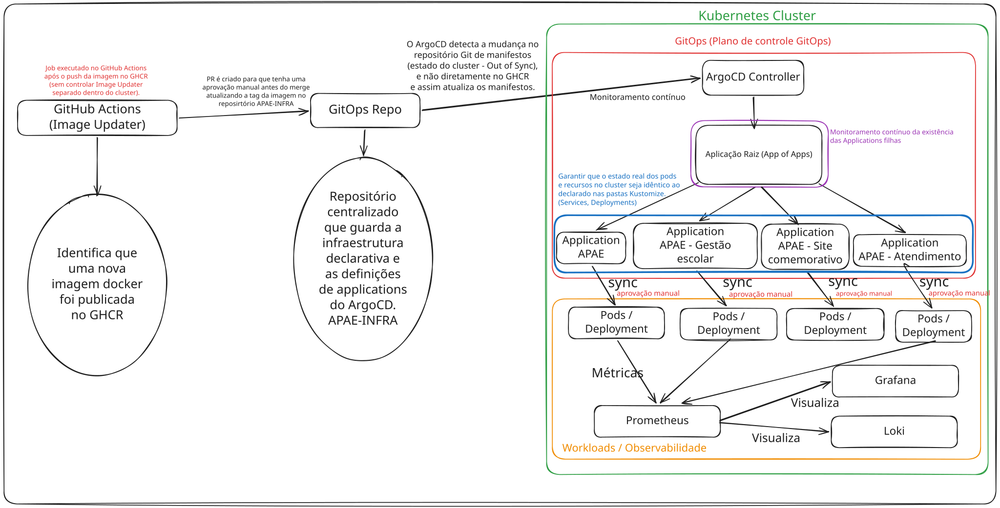

# Fluxo do ArgoCD (GitOps)

## Visão geral

O **APAE-INFRA** centraliza a configuração declarativa da infraestrutura e dos workloads Kubernetes da APAE. Os repositórios de produto (`APAE`, `APAE-atendimento`, `APAE-gestao-escolar` e `apae-site-comemorativo`) são responsáveis pelo código, testes, construção e publicação de imagens no **GitHub Container Registry (GHCR)**. Eles **não aplicam manifestos diretamente nos clusters**.

As alterações persistentes nos workloads são propostas e revisadas no APAE-INFRA. Após o merge na branch acompanhada por cada `Application`, o ArgoCD detecta diferenças e reconcilia somente os recursos sob sua responsabilidade, de acordo com a política de sincronização do ambiente.

**Exceção deliberada:** a instalação e atualização do próprio ArgoCD e os objetos de bootstrap (`AppProject`s e `Application` raiz) são administrados pelo **Ansible**, não pelo ArgoCD. O Git permanece como fonte de configuração versionada desses objetos, mas a aplicação deles é realizada pelo playbook de bootstrap. O Terraform gerencia a infraestrutura fundacional, sem disputar recursos Kubernetes com o ArgoCD.



> **Estado da implementação:** a issue [#91](https://github.com/IFPBEsp/APAE-INFRA/issues/91) implementa o bootstrap para o cluster k3s de produção. A estrutura de overlays e as Applications dos produtos são responsabilidade da [#92](https://github.com/IFPBEsp/APAE-INFRA/issues/92). O fluxo de homologação e promoção é tratado pela [#106](https://github.com/IFPBEsp/APAE-INFRA/issues/106). Os exemplos de ambientes futuros neste documento não indicam que seus clusters ou overlays já estejam implantados.

## Divisão de responsabilidades

| Componente | Responsabilidade | Não deve gerenciar |
| --- | --- | --- |
| Terraform | Infraestrutura fundacional e recursos de VPS definidos para IaC | Instalação/objetos internos do ArgoCD |
| Ansible | Instalação do k3s (issue #90); instalação, bootstrap, atualização e recuperação dos objetos de bootstrap do ArgoCD (issue #91) | Deployments, Services e Applications filhas atribuídos ao ArgoCD |
| ArgoCD | Descoberta e reconciliação das Applications filhas; recursos Kubernetes declarados por elas | Release Helm do próprio ArgoCD, `project.yaml`, `project-infra.yaml` e `app-of-apps.yaml` |
| GitHub Actions | CI dos produtos, publicação no GHCR e automações de PRs GitOps | Aplicação direta de manifests no cluster |

Nenhum recurso deve ter dois controladores concorrentes. Alterações em componentes administrados pelo Ansible exigem execução controlada do playbook; alterações em workloads administrados pelo ArgoCD devem passar pelo fluxo GitOps.

## Branch de referência e ambientes

### Decisão da issue #91: raiz de produção na `main`

O bootstrap inicial do ArgoCD será executado no **cluster k3s da VPS de produção**. A Application raiz `apae-root` acompanhará a branch **`main` do APAE-INFRA**, que é a referência aprovada para as definições GitOps de produção.

É importante distinguir três configurações:

1. **`targetRevision` da raiz:** branch onde ficam as definições das Applications filhas; inicialmente, `main`.
2. **`targetRevision` da filha:** branch ou revisão que contém os manifests de workload dessa Application.
3. **`source.path` da filha:** caminho do overlay Kustomize de destino, como `kubernetes/overlays/prod/apae`.

A branch da raiz **não seleciona automaticamente** o overlay `prod`. Isso depende de cada Application filha. Da mesma forma, um commit na `main` não significa, por si só, deploy automático em produção: uma filha com sincronização manual pode detectar `OutOfSync` sem aplicar a mudança.

O ArgoCD faz reconciliação periódica e pode ser notificado por webhook, caso configurado. Push no Git não deve ser descrito como implantação imediata nem como autorização para sincronizar workloads de produção.

### Matriz de referência para a evolução dos ambientes

| Ambiente | Branch GitOps de referência | Overlay Kustomize | Política esperada para workloads |
| --- | --- | --- | --- |
| Desenvolvimento | `dev` | `dev` | Automática, conforme #92 |
| Homologação | `main` | `hml` | Manual, conforme #106 |
| Produção | `main` | `prod` | Manual, conforme #106 |

A #92 contempla inicialmente os overlays `dev`; `hml` e `prod` e seu fluxo de promoção serão implementados nas issues correspondentes. A matriz acima é a **direção arquitetural**, não uma declaração de implantação concluída.

## AppProjects: governança e isolamento

O bootstrap da #91 aplica dois projetos Kubernetes no namespace `argocd`:

- **`apae`** (`argocd/project.yaml`): projeto das Applications dos produtos e, na configuração inicial, da Application raiz. Restringe os repositórios à origem APAE-INFRA e os destinos aos namespaces permitidos, inclusive `argocd` para criação das definições das filhas. As permissões definitivas dos produtos serão alinhadas à #92.
- **`apae-infra`** (`argocd/project-infra.yaml`): projeto de infraestrutura separado, inicialmente restrito à origem APAE-INFRA, ao namespace `argocd` e aos tipos estritamente necessários. As respectivas issues devem ampliar suas permissões **explicitamente** para cada novo componente; não se deve conceder acesso global indiscriminado.

Os `AppProject`s limitam o que o ArgoCD pode reconciliar, mas **não substituem** o RBAC nativo do Kubernetes, as permissões de serviço ou os controles de acesso administrativo.

Exemplo de permissões iniciais dos produtos, alinhadas ao manifesto da #91:

```yaml
# argocd/project.yaml
apiVersion: argoproj.io/v1alpha1
kind: AppProject
metadata:
  name: apae
  namespace: argocd
spec:
  description: Projeto GitOps dos produtos da APAE
  sourceRepos:
    - https://github.com/IFPBEsp/APAE-INFRA.git
  destinations:
    - server: https://kubernetes.default.svc
      namespace: argocd
    - server: https://kubernetes.default.svc
      namespace: 'apae-*'
  clusterResourceWhitelist: []
  orphanedResources:
    warn: true
```

A configuração concreta do projeto de infraestrutura encontra-se em `argocd/project-infra.yaml`. Qualquer ampliação deverá ser revisada e aplicada pelo Ansible.

## Padrão adotado: App of Apps

Adotamos o padrão **[App of Apps](https://argo-cd.readthedocs.io/en/stable/operator-manual/cluster-bootstrapping/)**. O Ansible cria `apae-root`, que monitora os manifests das Applications filhas no APAE-INFRA. As filhas, por sua vez, monitoram os overlays Kustomize dos produtos.

Os **dois ciclos independentes** são:

1. **Raiz:** observa alterações nas definições das Applications filhas sob `argocd/` e mantém esses objetos registrados no cluster.
2. **Filhas:** observam os overlays apontados em seus respectivos `spec.source.path` e sinalizam ou aplicam diferenças conforme sua política de sincronização.

Alterar a imagem ou o digest em um overlay, sem mudar as definições das filhas, normalmente afeta apenas a reconciliação da Application filha correspondente; não altera a definição gerenciada pela raiz.

### Estrutura inicial e responsabilidades

```text
argocd/
├── app-of-apps.yaml       # Application raiz, gerenciada pelo Ansible
├── project.yaml           # AppProject dos produtos, gerenciado pelo Ansible
├── project-infra.yaml     # AppProject de infraestrutura, gerenciado pelo Ansible
├── README.md
└── {produto}/             # Diretórios de Applications filhas, escopo da #92
    └── dev.yaml           # Exemplo de manifesto futuro; não é criado pela #91
```

A convenção e os diretórios concretos de Applications filhas serão definidos na #92. A #91 **não implanta os produtos nem cria seus overlays**.

### Application raiz de produção

O arquivo `argocd/app-of-apps.yaml`, administrado pelo Ansible, contém a seguinte configuração de origem:

```yaml
apiVersion: argoproj.io/v1alpha1
kind: Application
metadata:
  name: apae-root
  namespace: argocd
spec:
  project: apae
  source:
    repoURL: https://github.com/IFPBEsp/APAE-INFRA.git
    targetRevision: main
    path: argocd
    directory:
      recurse: true
      exclude: '{app-of-apps.yaml,project.yaml,project-infra.yaml}'
  destination:
    server: https://kubernetes.default.svc
    namespace: argocd
  syncPolicy:
    automated:
      selfHeal: true
      prune: true
    syncOptions:
      - CreateNamespace=false
```

A exclusão explícita de `app-of-apps.yaml`, `project.yaml` e `project-infra.yaml` impede que a raiz tente reconciliar os objetos de bootstrap administrados pelo Ansible. Os manifestos de instalação Helm do próprio ArgoCD também devem ficar **fora de qualquer Application** reconciliada pelo ArgoCD.

**Ponto de atenção:** `path: argocd` com `recurse: true` **não filtra ambientes**. Se a `main` contiver Applications filhas de desenvolvimento, homologação e produção nesse caminho, a raiz poderá descobri-las independentemente do ambiente. Antes de adicionar essas filhas e habilitar a sincronização efetiva da raiz, é necessário revisar os arquivos publicados e restringir a descoberta às Applications destinadas ao cluster de produção. A separação definitiva entre clusters ficará em issue futura, mas o risco deve ser tratado antes de qualquer deploy com múltiplos ambientes.

### Exemplo de Application filha de produção (futuro)

```yaml
apiVersion: argoproj.io/v1alpha1
kind: Application
metadata:
  name: apae-prod
  namespace: argocd
spec:
  project: apae
  source:
    repoURL: https://github.com/IFPBEsp/APAE-INFRA.git
    targetRevision: main
    path: kubernetes/overlays/prod/apae
  destination:
    server: https://kubernetes.default.svc
    namespace: apae-prod
  syncPolicy: {}  # sincronização manual
```

Esse é **um exemplo de projeto**, não um arquivo entregue na #91. O namespace, caminho e nomes efetivos devem ser confirmados na implementação dos overlays e das Applications.

### Evolução futura: ApplicationSet

Caso a quantidade de serviços e ambientes torne a manutenção manual repetitiva, poderá ser avaliado o uso de `ApplicationSet`, com geradores Git e templates versionados. A migração exige revisão de ownership, política de exclusão e identificação dos ambientes; não faz parte da #91.

## De onde cada Application lê os manifests

Os manifests comuns residem em diretórios base e as diferenças são definidas por overlays Kustomize:

```text
kubernetes/
├── base/
│   └── {produto}/
└── overlays/
    ├── dev/
    │   └── {produto}/
    ├── hml/             # futuro
    │   └── {produto}/
    └── prod/            # futuro
        └── {produto}/
```

O overlay define características específicas do ambiente, como namespace, réplicas, referências de imagem por digest e configurações não sensíveis. Secrets serão tratados pela estratégia definida na [#93](https://github.com/IFPBEsp/APAE-INFRA/issues/93).

Não é necessário duplicar todos os manifests base entre ambientes. Cada Application deve apontar para **um overlay compatível com o cluster onde está instalada**.

## Política de sincronização

| Recurso/ambiente | Política | Justificativa |
| --- | --- | --- |
| Application raiz (`apae-root`) | Automática, com `selfHeal` e `prune` | Mantém as **definições** das Applications filhas; exige revisão do conjunto descoberto antes de habilitar o fluxo |
| Applications filhas de desenvolvimento | Automática, conforme #92 | Agilidade no ambiente de desenvolvimento |
| Applications filhas de homologação | Manual, conforme #106 | Aprovação e validação antes da promoção |
| Applications filhas de produção | Manual, conforme #106 | Revisão humana obrigatória antes do deploy |

`prune` automático na raiz pode **remover uma Application filha** quando seu manifesto sair do Git. Isso pode ter efeitos nos workloads dependendo das finalizers e configurações de deleção. Exclusões de filhas devem ser revisadas como mudanças potencialmente destrutivas.

Para produção, um novo commit poderá deixar a Application em `OutOfSync`, mas a reconciliação dos workloads deve depender de sincronização manual autorizada. Não habilitar `syncPolicy.automated` nas filhas de produção como consequência implícita da política da raiz.

## Publicação de imagens, homologação e promoção — issue #106

A automação de imagens usa **GitHub Actions e PRs no APAE-INFRA**, e não o ArgoCD Image Updater dentro do cluster. O fluxo planejado na #106 é:

1. Um merge na `main` do **repositório do produto** aciona testes, build e scan.
2. As imagens aprovadas são publicadas no GHCR com tag `sha-<commit>` e digest.
3. O processo registra produto, commit, workflow e digests da combinação publicada, inclusive frontend/backend quando aplicável.
4. Uma automação verifica a proveniência da imagem e abre um **PR** atualizando o overlay de homologação no APAE-INFRA; não altera diretamente produção.
5. Após revisão e merge, a Application de homologação identifica a nova revisão; a sincronização é autorizada manualmente e a versão é validada.
6. Uma promoção explícita gera outro PR com **os mesmos digests validados**, sem novo build.
7. Após aprovação e merge do PR de promoção, o ArgoCD de produção identifica a alteração no overlay `prod`. O deploy ocorre apenas após **sync manual**.
8. O registro versionado da combinação aprovada permite auditoria e rollback para uma versão previamente validada.

Publicações de outras branches podem continuar existindo para desenvolvimento, mas **não participam automaticamente do fluxo de promoção para produção**. É essencial distinguir a `main` dos repositórios dos produtos (origem dos builds) da `main` do APAE-INFRA (origem dos manifests aprovados).

### Mudanças em configurações e manifests

Mudanças diretas no APAE-INFRA seguem o mesmo princípio: PR, revisão, merge e detecção de `OutOfSync` nas Applications afetadas. Em homologação e produção, o merge **não substitui a aprovação do sync manual**.

### Como o ArgoCD atualiza workloads

Quando uma Application filha é sincronizada, o ArgoCD aplica os manifests renderizados do overlay. Uma atualização de imagem em um Deployment normalmente produz um rolling update, respeitando a estratégia de rollout configurada. No primeiro deploy, os recursos são criados; nos seguintes, podem ser atualizados, mantidos ou removidos conforme as diferenças aprovadas.

## Bootstrap, operação e recuperação do ArgoCD — issue #91

O playbook `ansible/playbooks/argocd.yml` utiliza a role `ansible/roles/argocd_bootstrap/`, executada por SSH na VPS. As operações Kubernetes usam o **kubeconfig local do k3s** (`/etc/rancher/k3s/k3s.yaml`) e a API local (`https://127.0.0.1:6443`), sem copiar o kubeconfig para runners nem exigir exposição pública da API Kubernetes.

A sequência planejada é:

1. Verificar a disponibilidade do cluster e do kubeconfig.
2. Instalar/verificar o Helm com versão fixada e verificação de integridade.
3. Instalar/atualizar o chart oficial do ArgoCD com versões fixadas e recursos adequados à VPS.
4. Aguardar o estado de saúde dos componentes e o estabelecimento dos CRDs `Application`, `AppProject` e `ApplicationSet`.
5. Configurar senha administrativa e RBAC com proteção dos valores sensíveis, removendo a senha inicial após a substituição.
6. Aplicar pelo Ansible os dois AppProjects e a Application raiz.
7. Validar acesso por port-forward, sincronização de uma Application de teste e idempotência.

O acesso inicial ao ArgoCD será interno ao cluster (`ClusterIP`), disponibilizado por port-forward para administradores autorizados. Credenciais nunca devem ser versionadas, expostas em logs ou artefatos. Como o repositório APAE-INFRA é público, o ArgoCD poderá consumi-lo via HTTPS anônimo de **somente leitura**, sem token Git desnecessário. A política de Secrets dos workloads permanece na #93.

Antes de executar um upgrade, confirmar compatibilidade de versões, backup do estado do cluster e dos objetos de bootstrap, configuração de rollback e saúde do cluster. Em caso de recuperação, o Ansible reaplica os componentes sob sua responsabilidade; o ArgoCD retoma a reconciliação dos workloads atribuídos a ele. Os procedimentos operacionais detalhados e as evidências serão mantidos na documentação Ansible da #91, em articulação com os backups do k3s e a manutenção controlada da #117.

> **Validação pendente:** checks de sintaxe e YAML não comprovam instalação real, compatibilidade efetiva, convergência, segurança dos Secrets nem idempotência no cluster. Esses critérios precisam ser demonstrados antes de encerrar a #91.

## Evolução futura: VPS e clusters separados

A arquitetura planejada contempla **uma VPS e um cluster k3s independentes para desenvolvimento e produção**, cada um com sua própria instância do ArgoCD. Essa separação **não será implementada na #91**.

Ao planejar a issue futura, deverão ser definidos:

- Inventários, variáveis e bootstrap Ansible específicos por ambiente.
- Application raiz de Dev acompanhando `dev` e raiz de Prod acompanhando `main`.
- Descoberta restrita às Applications filhas correspondentes ao respectivo cluster.
- Overlays Kustomize `dev`, `hml` e `prod` e suas políticas de promoção.
- AppProjects, namespaces e permissões adaptados a cada cluster.
- Credenciais e Secrets isolados por ambiente.
- Conectividade administrativa segura, sem depender de exposição pública da API Kubernetes.
- Estratégia explícita para homologação (cluster próprio ou destino isolado), a ser decidida na issue correspondente.

**Não adotar** indiscriminadamente `path: argocd` com busca recursiva em ambos os clusters sem filtros de ambiente. A mesma branch pode conter definições de múltiplos ambientes, e cada raiz deve gerenciar apenas suas próprias Applications.

## Observabilidade

A arquitetura prevê monitoramento dos workloads e do cluster pela stack de observabilidade:

- **Prometheus:** métricas de Pods, Deployments e componentes Kubernetes.
- **Grafana:** visualização de métricas em dashboards.
- **Loki:** centralização e consulta de logs.

A instalação desses componentes depende das respectivas issues e de permissões específicas no `AppProject` de infraestrutura. A #91 não os instala.

## Referências

- [Issue #91 — Instalar e configurar o ArgoCD com Ansible](https://github.com/IFPBEsp/APAE-INFRA/issues/91)
- [Issue #92 — Applications e overlays por ambiente](https://github.com/IFPBEsp/APAE-INFRA/issues/92)
- [Issue #93 — Gestão de Secrets](https://github.com/IFPBEsp/APAE-INFRA/issues/93)
- [Issue #106 — Homologação e promoção de imagens](https://github.com/IFPBEsp/APAE-INFRA/issues/106)
- [Issue #117 — Manutenção controlada e contingência](https://github.com/IFPBEsp/APAE-INFRA/issues/117)
- [Documentação oficial — App of Apps](https://argo-cd.readthedocs.io/en/stable/operator-manual/cluster-bootstrapping/)
- [Diagrama do Fluxo do ArgoCD (SVG)](../diagramas/fluxo-argocd.svg)
- [Diagrama editável no Excalidraw](../diagramas/fluxo-argocd.excalidraw)
