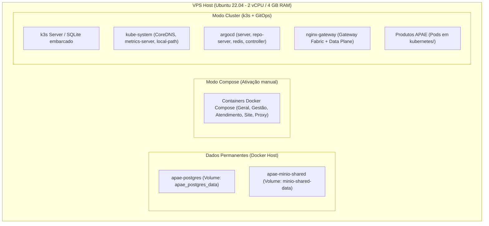

# Orçamento de Recursos e Validação de Capacidade da VPS

[← Voltar à documentação](../README.md)

Este documento consolida a validação teórica e o orçamento de capacidade de CPU, memória e disco da VPS da infraestrutura APAE-INFRA, atendendo à [issue #162](https://github.com/IFPBEsp/APAE-INFRA/issues/162).

---

## 1. Contexto e Especificações da VPS

A infraestrutura utiliza o plano contratado **HostGator VPS NVMe 4** com as seguintes especificações de hardware e medições reais obtidas no host:

| Recurso | Especificação Teórica | Medição Efetiva na VPS (`free -m`, `df`) | Observações |
| :--- | :--- | :--- | :--- |
| **vCPU** | 2 vCPUs | 2.000m (milicores) | Host com Load Average ~0.10 em repouso. |
| **Memória RAM** | 4 GB DDR5 | **3.915 MiB totais** (`MemTotal`) | ~1.907 MiB disponíveis no modo baseline atual. |
| **Swap** | - | **0 B (desativado)** | (Ponto de atenção) Sem swap configurado; OOMKill encerra processos imediatamente sob pressão. |
| **Disco** | 100 GB NVMe | **98 GB total / 17 GB usado (19%)** | **77 GB livres** em `/` (`/dev/sda3`). |
| **Sistema Operacional** | Ubuntu 22.04 LTS | Kernel Linux 5.15+ | Hostname: `vpsbr-16164680.vpshostgator.com.br`. |

---

## 2. Inventário de Componentes por Modo de Operação

O repositório opera sob dois modos mutuamente exclusivos para as aplicações ([issue #140](https://github.com/IFPBEsp/APAE-INFRA/issues/140)), preservando os serviços de dados compartilhados no Docker host:

### Tabela Comparativa de Componentes

| Componente | Tipo de Execução | Modo Compose | Modo Cluster | Persistência / Volume |
| :--- | :--- | :---: | :---: | :--- |
| **Kernel / daemons SO** | Nativo (Host) | Sim | Sim | Filesystem raiz (`/`) |
| **`apae-postgres`** | Docker Host | Sim | Sim | Volume nomeado `apae_postgres_data` |
| **`apae-minio-shared`** | Docker Host | Sim | Sim | Volume nomeado `apae-minio-shared_minio-shared-data` |
| **Docker daemon** | Systemd | Sim | Sim | `/var/lib/docker` |
| **k3s runtime / containerd** | Systemd | Não | Sim | `/var/lib/rancher/k3s` |
| **CoreDNS, metrics-server** | Pods `kube-system` | Não | Sim | Efêmero |
| **ArgoCD (4 workloads)** | Pods `argocd` | Não | Sim | Redis ephem / repo-server cache |
| **NGINX Gateway Fabric** | Pods `nginx-gateway` | Não | Sim | Efêmero |
| **Workloads Produtos (8 pods)** | Pods `kubernetes/` | Não | Sim | Stateless (consumo via Postgres/MinIO) |
| **Aplicações legadas Compose** | Docker Compose | Sim | Não | Volumes Compose |

---

## 3. Orçamento Teórico de Recursos no Modo Cluster

### 3.1. Reservas de Recursos no Kubelet

Conforme implementado no template Ansible `ansible/roles/k3s/templates/config.yaml.j2`:

| Parâmetro Kubelet | CPU | Memória | Finalidade |
| :--- | :---: | :---: | :--- |
| `system-reserved` | 250m | 512 MiB | Sistema operacional, SSH, Docker, `apae-postgres`, `apae-minio-shared` |
| `kube-reserved` | 250m | 512 MiB | Processos `k3s server`, `containerd`, `kubelet` |
| **Subtotal Reservas** | **500m** | **1.024 MiB** | **Reserva obrigatória do nó** |

> **Capacidade Efetiva Alocável para Pods (Node Allocatable):**
>
> * **CPU Alocável:** $2.000\text{m} - 500\text{m} = \mathbf{1.500\text{m}}$
> * **Memória Alocável:** $3.725\text{ MiB} - 1.024\text{ MiB} - \text{Eviction Threshold (100 MiB)} \approx \mathbf{2.600\text{ MiB}}$

---

### 3.2. Plataforma Base do Cluster (kube-system + ArgoCD + Gateway)

Comparativo entre os valores declarados nos manifests e o **consumo real medido** na VPS via `kubectl top`:

| Componente | Pod / Deployment | Request CPU | Request RAM | Consumo Real CPU | Consumo Real RAM | Limit CPU | Limit RAM |
| :--- | :--- | :---: | :---: | :---: | :---: | :---: | :---: |
| `kube-system` | `coredns` | 100m | 70 MiB | **2m** | **22 MiB** | 200m | 170 MiB |
| `kube-system` | `metrics-server` | 100m | 100 MiB | **3m** | **33 MiB** | 200m | 200 MiB |
| `kube-system` | `local-path-provisioner` | 50m | 50 MiB | **1m** | **13 MiB** | 100m | 100 MiB |
| `kube-system` | `sealed-secrets-controller` | **50m** | **64 MiB** | **1m** | **8 MiB** | **200m** | **128 MiB** |
| `argocd` | `argocd-application-controller` | 100m | 256 MiB | **2m** | **243 MiB** | 500m | 768 MiB |
| `argocd` | `argocd-server` | 50m | 128 MiB | **1m** | **39 MiB** | 300m | 384 MiB |
| `argocd` | `argocd-repo-server` | 100m | 128 MiB | **1m** | **45 MiB** | 500m | 512 MiB |
| `argocd` | `argocd-redis` | 25m | 64 MiB | **3m** | **8 MiB** | 200m | 192 MiB |
| `nginx-gateway` | `ngf-nginx-gateway-fabric` | 100m | 128 MiB | **3m** | **37 MiB** | 500m | 256 MiB |
| `nginx-gateway` | `apae-gateway-nginx` | 100m | 128 MiB | **7m** | **45 MiB** | 500m | 256 MiB |
| **Total Plataforma** | *(10 pods)* | **775m** | **1.116 MiB** | **24m (1,2%)** | **493 MiB** | **3.200m** | **2.966 MiB** |

> **Descoberta da Medição Real:** Em repouso, a plataforma consome apenas **24m de CPU** e **493 MiB de RAM real** (menos da metade dos 1.052 MiB solicitados via requests). Isso comprova empiricamente que os requests atuais estão superdimensionados para o repouso.

---

### 3.3. Produtos e Aplicações da Plataforma (Manifests Declarados)

Valores declarados nos manifests em `kubernetes/*/base/`:

| Produto | Workload | Runtime / Stack | Request CPU | Request RAM | Limit CPU | Limit RAM |
| :--- | :--- | :--- | :---: | :---: | :---: | :---: |
| **APAE Geral** | `api` | Node / Nest / Python | 100m | 256 MiB | 500m | 512 MiB |
| **APAE Geral** | `apae` | Frontend Web | 100m | 128 MiB | 500m | 256 MiB |
| **APAE Geral** | `management-app` | Frontend Web | 100m | 128 MiB | 500m | 256 MiB |
| **Gestão Escolar** | `backend` | Java / Spring Boot | 250m | 256 MiB | 1.000m | 512 MiB |
| **Gestão Escolar** | `frontend` | Next.js / Node | 100m | 128 MiB | 500m | 256 MiB |
| **Atendimento** | `atendimento` | Backend | 100m | 256 MiB | 500m | 512 MiB |
| **Atendimento** | `atendimento-app` | Frontend Next.js | 100m | 128 MiB | 500m | 256 MiB |
| **Site Comemorativo** | `site-comemorativo` | Next.js / Node | 100m | 128 MiB | 500m | 256 MiB |
| **Subtotal Produtos** | *(8 pods)* | | **950m** | **1.408 MiB** | **4.500m** | **2.816 MiB** |

---

## 4. Balanço Geral de Capacidade

Comparativo entre a capacidade alocável do nó e a demanda consolidada:

| Métrica | CPU Alocável | Memória Alocável | Observações |
| :--- | :---: | :---: | :--- |
| **Capacidade Disponível para Pods** | **1.500m** | **2.600 MiB** | Após reservas de SO e k3s |
| Demandas Plataforma (Requests) | 725m | 1.052 MiB | ArgoCD, NGF, kube-system |
| Demandas Produtos (Requests) | 950m | 1.408 MiB | 8 pods de produtos |
| **Soma Total dos Requests** | **1.675m** | **2.460 MiB** | Concorrência de todos os pods |
| **Saldo / Folga de Agendamento** | **-175m** *(déficit)* | **+140 MiB** *(~5%)* | **Risco de agendamento rejeitado** |
| **Soma Total dos Limits** | **7.500m** *(375%)* | **5.654 MiB** *(152%)* | Risco severo de OOMKill sob estresse |

> **Alerta de Saturação Teórica:**
>
> 1. A soma dos **CPU Requests** (1.675m) ultrapassa a capacidade alocável de CPU (1.500m) em **175m**. O Kubelet rejeitará o agendamento de pelo menos um pod se todos forem ativados com esses requests.
> 2. A margem de **Memória RAM** restante é de apenas **140 MiB (~5%)**. Qualquer oscilação ou pico de inicialização provocará eviction ou OOMKill.

---

## 5. Análise de Picos Operacionais e Riscos

### 5.1. Risco no `system-reserved` (512 MiB)

O `system-reserved` reserva apenas 512 MiB para o sistema host. Nele rodam:

* PostgreSQL (`apae-postgres`)
* MinIO (`apae-minio-shared`)
* Docker Daemon e SSH

Se o PostgreSQL executar queries complexas ou o MinIO realizar uploads concorrentes (teto técnico de 50 MB por upload), o consumo excederá 512 MiB, competindo com a memória do nó e podendo induzir o Linux OOM-Killer a encerrar containers vitais.

### 5.2. Picos de Rollout / Deploy Concorrente

O Kubernetes por padrão utiliza estratégia `RollingUpdate` em Deployments (criando novos pods antes de destruir os antigos). Como a margem de memória é de apenas 140 MiB, **qualquer rollout de produto falhará por falta de memória para agendar a nova réplica**.

* **Mitigação Obrigatória:** Adotar `strategy.type: Recreate` nos manifests dos produtos.

### 5.3. Pico de Backup (#108)

A execução de dumps (`pg_dump`) combinada com a compressão e criptografia do `restic` causa picos temporários de CPU (podendo saturar 1 vCPU inteira) e alocação de buffers em disco e RAM.

---

## 6. Recomendações e Plano de Ajuste

1. **Readequação dos Requests nos Manifests:**
   * **Frontends Web:** Reduzir requests de CPU de 100m para 25m–50m e memória de 128 MiB para 64–96 MiB.
   * **Backends APIs:** Reduzir requests de CPU de 100m/250m para 50m–100m.
   * Com esses ajustes, a soma de requests cai para ~500m CPU e ~1.900 MiB RAM, garantindo uma folga de segurança de ~700 MiB (~27%) para picos.
2. **Ativação Escalonada:**
   * Não ativar todos os produtos de uma só vez. Iniciar com APAE Geral e Site Comemorativo, medindo o consumo antes de ativar Gestão Escolar e Atendimento.
3. **Plano de Contingência (Upgrade de VPS):**
   * Caso a validação empírica confirme pressão de memória contínua com todos os produtos ligados, formalizar o pedido de ampliação da VPS para 4 vCPUs / 8 GB de RAM.
