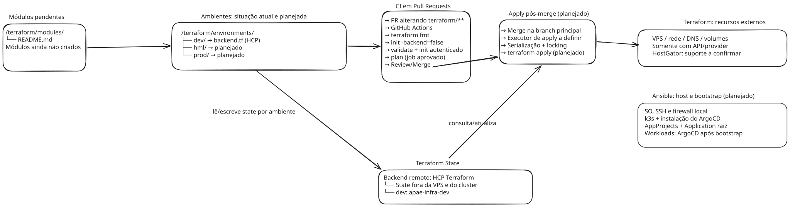

# Fluxo e Arquitetura do Terraform — APAE-INFRA

## Visão Geral

A infraestrutura utiliza uma VPS **HostGator** existente. Conforme o [ADR 004](https://github.com/IFPBEsp/APAE-INFRA/blob/dev/docs/adr/004-adocao-ansible-github-actions.md), o Ansible é responsável pela configuração e manutenção do host, instalação do k3s e instalação/atualização do ArgoCD. O Terraform fica restrito aos recursos externos ao host quando houver API ou provider suportado.

A integração Terraform com o plano HostGator ainda precisa ser confirmada. O provisionamento externo sem integração suportada deve ser registrado como exceção; não é pré-requisito para configurar a VPS existente com Ansible. As responsabilidades estão definidas arquiteturalmente, mas isso não comprova implantação dos componentes.



## Organização de Módulos

Atualmente, `terraform/modules/` contém apenas um `README.md`; não há módulos Terraform implementados. A organização anterior em `kubernetes-cluster/`, `network/`, `compute/` e `object-storage/` não representa a estrutura existente.

Os futuros módulos deverão ser definidos a partir dos recursos externos com integração confirmada, por exemplo VPS, rede, DNS e volumes do provedor. A instalação do cluster e a configuração do sistema operacional pertencem ao Ansible. Armazenamento de objetos não possui módulo nem solução de implantação definidos neste fluxo; sua necessidade e ferramenta responsável deverão ser avaliadas antes da implementação.

## Separação por Ambiente

A estrutura já presente na branch `dev`, após o [PR #101](https://github.com/IFPBEsp/APAE-INFRA/pull/101), é:

```text
terraform/
├── modules/
│   └── README.md
└── environments/
    ├── README.md
    └── dev/
        └── backend.tf
```

| Ambiente | Situação | Workspace HCP Terraform |
| --- | --- | --- |
| `dev` | Backend configurado e validado; não comprova provisionamento de recursos | `apae-infra-dev` |
| `hml` | Diretório e backend planejados | `apae-infra-hml` (planejado) |
| `prod` | Diretório e backend planejados | `apae-infra-prod` (planejado) |

O consumo de módulos por ambiente será implementado quando esses módulos existirem e seu escopo estiver definido. Cada ambiente deverá manter state independente.

## Terraform State

A decisão atual é armazenar o state remotamente no **HCP Terraform**, fora da VPS e do cluster, conforme a implementação do [PR #101](https://github.com/IFPBEsp/APAE-INFRA/pull/101). A proposta anterior de manter `terraform.tfstate` na VPS foi substituída por esse backend.

- **Ambientes:** o workspace `apae-infra-dev` está configurado e validado. Os workspaces independentes `apae-infra-hml` e `apae-infra-prod` permanecem planejados.
- **Executor e acesso:** na CI de Pull Requests, o Terraform CLI executa no runner do GitHub Actions e acessa o HCP Terraform pela API autenticada do backend. O workspace usa o modo de execução local: o HCP armazena o state e controla seu lock, mas não executa o Terraform. Não há acesso ao state por SSH nem por montagem de um diretório da VPS.
- **Credenciais:** a inicialização autenticada e o `plan` usam a credencial do HCP disponibilizada ao job aprovado no ambiente `terraform-plan`. A configuração do executor e das credenciais do futuro `apply` ainda precisa ser definida; não é implementada neste PR.

### Concorrência, serialização e locking

Executar o `apply` somente após o merge **não impede execuções simultâneas**: merges consecutivos, reexecuções e comandos locais podem disputar o mesmo state. O fluxo de aplicação deve combinar duas proteções:

1. **Serialização no executor:** o futuro workflow de `apply` deverá usar um grupo de `concurrency` por ambiente/workspace, compartilhado pelas execuções que alteram o mesmo state, com `cancel-in-progress: false` para não interromper uma aplicação em andamento. Agrupar apenas pelo número do PR não serializa aplicações de PRs diferentes. Essa automação permanece pendente.
2. **Locking no backend:** o locking nativo do HCP Terraform protege o state também contra operações concorrentes originadas fora daquele workflow. Todas as operações devem usar o workspace correto e manter o locking habilitado. Uma falha ao adquirir o lock deve interromper a operação; não deve ser contornada com `-lock=false`.

O PR #101 registrou a validação do bloqueio administrativo e do desbloqueio do workspace `dev`. Não foi realizado um teste específico com duas operações concorrentes tentando adquirir o mesmo lock. Portanto, a configuração do backend não comprova que a serialização do futuro `apply` já esteja implementada ou validada.

## Fluxo de plan/apply

O fluxo é dividido em duas etapas distintas:

### Etapa 1 — CI em Pull Requests

O workflow de validação Terraform da branch `dev` executa em PRs para `dev` ou `main` que alterem `terraform/**`. A sequência de validação é:

1. `terraform fmt` — verifica formatação
2. `terraform init -backend=false` — inicializa dependências para validação sem acessar o backend remoto
3. `terraform validate` — valida a sintaxe dos arquivos
4. `terraform init` autenticado e `terraform plan` — inicializa o backend remoto e exibe as mudanças propostas, após aprovação do ambiente `terraform-plan`; essa etapa não executa para PRs de forks

O `terraform apply` **não é executado nesta etapa**. O resultado do `plan` serve como evidência para revisão do time antes do merge.

### Etapa 2 — Apply pós-merge (GitOps)

O fluxo desejado é aplicar as mudanças revisadas após o merge na branch principal. O mecanismo e o executor definitivo do `terraform apply`, suas aprovações e a serialização por workspace ainda precisam ser definidos e implementados; este PR não configura uma aplicação automática pós-merge.

Antes de habilitar essa etapa, o executor deverá acessar o backend remoto autenticado e atender aos requisitos de serialização e locking descritos acima. O Git permanece como fonte da configuração desejada, com mudanças revisadas por PR antes da aplicação.

## Responsabilidades e implementação pendente

| Escopo | Responsável | Situação e limite |
| --- | --- | --- |
| VPS, rede, DNS, volumes e firewall do provedor | Terraform, quando houver integração suportada | Módulos e compatibilidade com a HostGator pendentes; não implica provisionamento realizado |
| Sistema operacional, usuários, SSH e firewall local | Ansible | Configuração e manutenção do host; automação tratada na issue #90 |
| Instalação e manutenção do k3s | Ansible | Não é responsabilidade de um módulo Terraform de Kubernetes |
| Instalação/atualização do ArgoCD, AppProjects e Application raiz | Ansible | Objetos de bootstrap mantidos fora do caminho reconciliado pelo ArgoCD |
| Applications filhas e recursos Kubernetes atribuídos a elas | ArgoCD | Workloads, observabilidade e infraestrutura Kubernetes, conforme escopo e política de sincronização definidos |

A consolidação do escopo entre Terraform, Ansible e ArgoCD é acompanhada na [issue #86](https://github.com/IFPBEsp/APAE-INFRA/issues/86). A implementação do host e do k3s pertence à [issue #90](https://github.com/IFPBEsp/APAE-INFRA/issues/90). Este documento não afirma que módulos, automação de apply ou componentes do cluster já estejam implantados.
