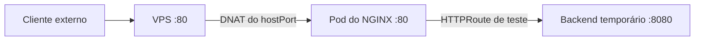

# Evidências de origem das requisições no Gateway — issue #114

## Caminho da conexão HTTP

O teste foi executado em 11/11/2026, no horário de Recife. O data plane
estava exposto por `hostPort: 80`. O `iptables` confirmou o DNAT da porta
80 da VPS para a porta 80 do pod do NGINX. As regras desse `hostPort`
marcavam para `MASQUERADE` as origens da sub-rede local de pods e de
loopback.



Em 12/11/2026 às 19:52 (horário de Recife), uma requisição HTTP externa
feita sem proxy recebeu `404` no caminho `/__issue-114-ip-compare`.
O IPv4 registrado pelo NGINX coincidiu com o IPv4 público de saída
consultado no ipify na mesma sessão. Isso confirmou a preservação do
IPv4 de origem até o data plane no caminho testado via `hostPort:80`.

## Headers recebidos pelo backend

| Header | Sem falsificação | Com falsificação, antes do filtro | Com falsificação, após o filtro |
| --- | --- | --- | --- |
| `X-Forwarded-For` | IP observado pelo NGINX | IP falso seguido do IP observado pelo NGINX | Ausente |
| `X-Real-IP` | IP observado pelo NGINX | IP observado pelo NGINX | IP observado pelo NGINX |
| `X-Forwarded-Proto` | `http` | `http` | `http` |
| `X-Forwarded-Host` | `issue-114-headers.test` | `issue-114-headers.test` | `issue-114-headers.test` |

O filtro `RequestHeaderModifier` com `remove: [X-Forwarded-For]` removeu
o header nas requisições com e sem falsificação. A HTTPRoute, o Pod e o
Service temporários foram excluídos ao fim do teste.

## HTTPS, reinício do k3s e exposição externa

Em 12/11/2026, duas requisições externas por HTTPS, uma normal e outra
com os quatro headers falsificados, retornaram os mesmos valores com a
verificação do certificado TLS ativa. O backend temporário recebeu
`X-Forwarded-For` ausente, `X-Forwarded-Proto: https`,
`X-Forwarded-Host: issue-114-headers.test` e `X-Real-IP` igual ao IPv4
público de saída confirmado no teste HTTP. O IP de origem da conexão TCP
no backend era o do pod do NGINX.

Após reiniciar o serviço k3s, a requisição HTTPS com headers falsificados
foi repetida e retornou os mesmos valores. A varredura externa por IPv4
verificou dez portas TCP na VPS.

| Etapa (horário de Recife) | Abertas | Fechadas | Filtradas |
| --- | --- | --- | --- |
| Antes do reinício, 20:01 | 80, 443 | 3000, 5432, 8080, 9000, 9001, 9113 | 6443, 10250 |
| Após o reinício, 20:02 | 80, 443 | 3000, 5432, 8080, 9000, 9001, 9113 | 6443, 10250 |
| Após a limpeza, 20:04 | 80 | 443, 3000, 5432, 8080, 9000, 9001, 9113 | 6443, 10250 |

A rota, o Pod, o Service, o listener HTTPS e o Secret TLS temporários
foram removidos. O rollout do data plane foi concluído após a limpeza.
A aplicação do filtro às rotas definitivas da #113 e a validação dos
headers nas aplicações dos produtos continuam pendentes.

## Configuração prevista para as rotas dos produtos

Adicionar este filtro a cada regra de HTTPRoute que encaminha tráfego público
para um produto. Se a regra já tiver filtros, incluir este na lista existente.

```yaml
filters:
  - type: RequestHeaderModifier
    requestHeaderModifier:
      remove:
        - X-Forwarded-For
```

Os testes HTTP e HTTPS confirmaram a remoção de `X-Forwarded-For` e o preenchimento de
`X-Real-IP`, `X-Forwarded-Proto` e `X-Forwarded-Host` pelo Gateway. Antes de
usar esses valores nas aplicações, validar quais proxies podem alcançá-las
e como cada proxy interno trata os headers.

Na topologia testada, o Gateway recebe a conexão externa diretamente.
A configuração prevista mantém `rewriteClientIP` e PROXY Protocol
desabilitados.
