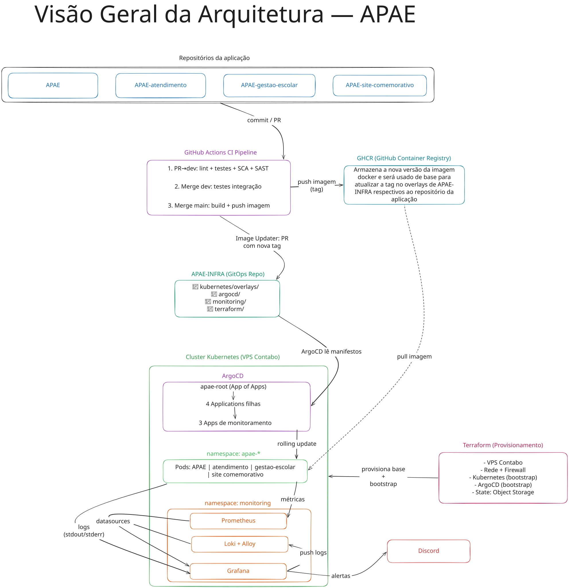

# Visão Geral da Arquitetura de Infraestrutura — APAE

Este documento apresenta uma visão de alto nível de como todas as peças da infraestrutura APAE se conectam: repositórios de aplicação, provisionamento via Terraform, build e entrega de imagens (GitHub Actions), entrega contínua via ArgoCD e observabilidade. Funciona como ponto de entrada para a documentação de infraestrutura, com referências para os documentos detalhados de cada fluxo.



---

## Os cinco pilares da arquitetura

### 1. Repositórios de Aplicação

O projeto APAE é composto por quatro repositórios de código-fonte, cada um representando um sistema independente:

| Repositório | Responsabilidade |
| --- | --- |
| [APAE](https://github.com/IFPBEsp/APAE) | Sistema principal (backend Spring Boot) |
| [APAE-atendimento](https://github.com/IFPBEsp/APAE-atendimento) | Sistema de atendimento |
| [APAE-gestao-escolar](https://github.com/IFPBEsp/APAE-gestao-escolar) | Sistema de gestão escolar |
| [apae-site-comemorativo](https://github.com/IFPBEsp/apae-site-comemorativo) | Site comemorativo |

Cada repositório de aplicação segue o mesmo ciclo de vida, de forma completamente independente dos demais. Eles **não se comunicam entre si** nem aplicam nada diretamente no cluster — toda a orquestração passa pelo **APAE-INFRA**.

### 2. Provisionamento e Gerenciamento de Infraestrutura — Terraform, Ansible e GitHub Actions

A gestão da infraestrutura fundacional e do host é dividida de forma clara entre **Terraform** e **Ansible**, com orquestração via **GitHub Actions**:

- **Terraform:** Responsável pelos recursos externos ao host (infraestrutura externa como VPS HostGator, rede, DNS e firewall do provedor quando houver API/provider suportado; caso contrário, registrado como exceção). O state é armazenado remotamente no **HCP Terraform Free** (workspace `apae-infra-dev` já configurado e validado para o ambiente de desenvolvimento, com workspaces para `hml` e `prod` planejados), oferecendo locking nativo e histórico centralizado fora da VPS e do cluster. O Terraform é executado pelo GitHub Actions (`fmt`, `validate`, `plan` e aprovação antes do `apply`), e não pelo ArgoCD, evitando dependências circulares de bootstrap.
- **Ansible:** Responsável pela configuração e manutenção do sistema operacional da VPS HostGator (Ubuntu 22.04 LTS), usuários, SSH, pacotes, firewall local (UFW), instalação, versionamento e manutenção do cluster Kubernetes (**k3s single-node**), além da instalação inicial e atualizações do **ArgoCD** com versão fixada e validada.
- **Objetos de bootstrap mantidos sob o Ansible:** O **AppProject de bootstrap**, o **AppProject de infraestrutura** (`project-infra.yaml`) e a **Application raiz** (`app-of-apps.yaml`) permanecem sob a responsabilidade do Ansible enquanto estiverem excluídos do caminho reconciliado pelo ArgoCD, garantindo que o ArgoCD não dispute o gerenciamento de sua própria base.

Após essa etapa de bootstrap realizada pelo Ansible, o ArgoCD passa a reconciliar exclusivamente os recursos e Applications sob seu escopo.

### 3. Build e Entrega de Imagens — GitHub Actions (CI)

Cada repositório de aplicação possui um pipeline de CI em três estágios:

1. **PR para `dev`** — lint, testes, build, validação do Dockerfile, análise SCA (dependências vulneráveis) e análise SAST via SonarQube.
2. **Merge na `dev`** — testes de integração.
3. **Merge na `main`** — build da imagem Docker, push para o **GHCR (GitHub Container Registry)** e **Image Updater**: um job que abre um PR no APAE-INFRA atualizando a tag da imagem no overlay Kustomize correspondente.

O ArgoCD não acessa o GHCR diretamente — ele lê apenas o APAE-INFRA e reage à mudança de tag nos manifestos.

> Detalhes: [docs/fluxo-comunicacao-repositorios.md](fluxo-comunicacao-repositorios.md)

### 4. Entrega Contínua — ArgoCD (GitOps)

O **APAE-INFRA** é o repositório GitOps: a única fonte de verdade lida pelo ArgoCD. O padrão adotado é o **App of Apps**:

- **`apae-root`** (Application raiz) — monitora `argocd/` com busca recursiva e garante que as 4 Applications filhas existam no cluster.
- **4 Applications filhas** — cada uma aponta para o overlay Kustomize correspondente em `kubernetes/{produto}/overlays/dev/` (como `kubernetes/apae-geral/overlays/dev`) e sincroniza de forma independente.

**Política de sincronização definida para a implementação:** sync **manual** em todas as Applications filhas. O ArgoCD sinaliza "Out of Sync", mas só aplica quando alguém aprovar manualmente (UI ou CLI). Essa política será reavaliada quando o pipeline de CI/CD tiver testes obrigatórios e histórico estável de releases.

Todo o estado dos workloads é descrito nos manifestos do APAE-INFRA. **Não há `kubectl apply` manual** nas aplicações — qualquer mudança nos recursos reconciliados pelas Applications filhas passa por um commit no APAE-INFRA seguido de aprovação de sync no ArgoCD. Exceção feita aos componentes de bootstrap (instalação e atualização do próprio ArgoCD, AppProjects e a Application raiz), cujas alterações são aplicadas e gerenciadas exclusivamente pelo fluxo controlado do Ansible.

> Detalhes: [docs/argocd/fluxo-argocd.md](argocd/fluxo-argocd.md)

### 5. Observabilidade — Prometheus, Loki e Grafana

A stack de observabilidade está prevista para rodar no **namespace `monitoring`** do mesmo cluster, gerenciada pelo mesmo padrão GitOps (Applications filhas do ArgoCD lendo de `monitoring/`):

| Componente | Função |
| --- | --- |
| **Prometheus** | Coleta métricas dos Pods, nodes (node-exporter), estado do cluster (kube-state-metrics) e do próprio ArgoCD |
| **Loki + Grafana Alloy** | Centraliza logs dos containers (Alloy como agente DaemonSet, substituto do Promtail descontinuado) |
| **Grafana** | Dashboards por aplicação e por cluster; datasources provisionados via GitOps |
| **Grafana Alerting** | Regras de alerta com notificação via Discord |

Descoberta de alvos do Prometheus via **Prometheus Operator** (`ServiceMonitor` / `PodMonitor`), declarativo e alinhado ao GitOps.

> Detalhes: [docs/fluxo-observabilidade.md](fluxo-observabilidade.md)

---

## Como uma mudança se propaga até o cluster

```text
┌──────────────────────────────────────────────────────────────────────────────────┐
│ Repositório de Aplicação                                                         │
│  commit → PR → CI (lint/testes/build) → merge main                              │
│    → build imagem Docker → push GHCR → Image Updater abre PR no APAE-INFRA     │
└────────────────────────────────┬─────────────────────────────────────────────────┘
                                 │ PR revisado + mergeado
                                 ▼
┌──────────────────────────────────────────────────────────────────────────────────┐
│ APAE-INFRA (GitOps repo)                                                         │
│  kubernetes/{produto}/overlays/dev/kustomization.yaml  ← tag atualizada           │
└────────────────────────────────┬─────────────────────────────────────────────────┘
                                 │ ArgoCD detecta Out-of-Sync
                                 │ Aprovação manual → sync
                                 ▼
┌──────────────────────────────────────────────────────────────────────────────────┐
│ Cluster Kubernetes                                                               │
│  ArgoCD aplica rolling update → Pods sobem com a nova imagem do GHCR            │
│  Prometheus + Loki coletam métricas/logs → Grafana exibe dashboards             │
└──────────────────────────────────────────────────────────────────────────────────┘
```

---

## Estrutura do Repositório APAE-INFRA

Para assegurar clareza e transparência no ciclo de vida do repositório, distinguimos a **estrutura atualmente existente** da **organização planejada** (em fase de estudo ou com componentes pendentes de implementação):

### Estrutura Atual (Existente)

Atualmente, os manifests Kubernetes base estão organizados por produto (`kubernetes/{produto}/base/`), e diretórios como `argocd/` e `monitoring/` contêm documentação e estudos:

```text
APAE-INFRA/
├── .github/
│   └── workflows/          # Workflows de CI, linting e validação
├── kubernetes/
│   ├── apae-geral/
│   │   └── base/           # Manifests base do backend e microsserviços gerais
│   ├── apae-atendimento/
│   │   └── base/           # Manifests base do serviço de atendimento
│   └── site-comemorativo/
│       └── base/           # Manifests base do site comemorativo
├── terraform/
│   ├── environments/       # Configuração por ambiente (dev com backend.tf configurado no HCP Terraform)
│   └── modules/            # Módulos reutilizáveis
├── argocd/                 # Documentação e especificações conceituais do ArgoCD
├── monitoring/             # Documentação da stack de observabilidade (Grafana, Loki, Prometheus)
└── docs/                   # Documentação arquitetural, ADRs e diagramas
    └── diagramas/          # Diagramas Excalidraw e SVG
```

### Estrutura Planejada e Componentes Pendentes

A arquitetura final do GitOps prevê a introdução de camadas e componentes que estão planejados ou em desenvolvimento:

```text
APAE-INFRA/
├── argocd/                 # [Planejado] Manifests do App of Apps: project.yaml, project-infra.yaml, app-of-apps.yaml
├── kubernetes/
│   └── {produto}/
│       ├── base/           # [Existente] Manifests comuns
│       └── overlays/{env}/ # [Planejado] Kustomize overlays por ambiente (dev, hml, prod) para réplicas e tags
├── monitoring/
│   ├── grafana/            # [Planejado] Manifests de datasources, dashboards e alertas provisionados via GitOps
│   ├── prometheus/         # [Planejado] Prometheus Operator, ServiceMonitors e PodMonitors
│   └── loki/               # [Planejado] Workloads de Loki e Grafana Alloy (DaemonSet)
├── ansible/                # [Planejado] Playbooks e roles de configuração do host, k3s e bootstrap do ArgoCD
└── terraform/
    └── environments/
        ├── dev/            # [Configurado] Backend HCP Terraform e validações
        ├── hml/            # [Planejado] Workspace apae-infra-hml
        └── prod/           # [Planejado] Workspace apae-infra-prod
```

> [!NOTE]
> Os overlays Kustomize por ambiente (`kubernetes/{produto}/overlays/{env}/`), as Applications declarativas do ArgoCD (`argocd/*.yaml`), a stack ativa de observabilidade em cluster (`monitoring/*`) e a automação do host via Ansible estão formalizados conceitualmente em seus respectivos estudos arquiteturais e serão implementados nas próximas etapas da infraestrutura.

---

## Documentação detalhada por fluxo

| Fluxo | Documento |
| --- | --- |
| Comunicação entre repositórios e CI/CD | [docs/fluxo-comunicacao-repositorios.md](fluxo-comunicacao-repositorios.md) |
| Terraform — arquitetura e decisões | [docs/terraform/README.md](terraform/README.md) |
| ArgoCD — GitOps e App of Apps | [docs/argocd/fluxo-argocd.md](argocd/fluxo-argocd.md) |
| Observabilidade — Prometheus, Loki, Grafana | [docs/fluxo-observabilidade.md](fluxo-observabilidade.md) |
| Boas práticas gerais | [docs/boas-praticas/](boas-praticas/) |

---

## Diagramas

- [Diagrama de Visão Geral (SVG)](diagramas/visao-geral-arquitetura.svg)
- [Diagrama de Visão Geral (Excalidraw editável)](diagramas/visao-geral-arquitetura.excalidraw)
- [Fluxo do ArgoCD (SVG)](diagramas/fluxo-argocd.svg)
- [Fluxo de Comunicação entre Repositórios (SVG)](diagramas/fluxo-comunicacao-repositorios.svg)
- [Fluxo de Observabilidade (SVG)](diagramas/fluxo-observabilidade.svg)

Issue relacionada: `APAE-INFRA#14`
